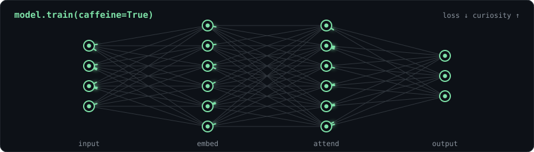

<!-- ===================== HEADER ===================== -->
<p align="center">
  
</p>

<p align="center">
  <a href="https://git.io/typing-svg">
    
  </a>
</p>

<p align="center">
  <a href="https://github.com/amantebriwal4321?tab=followers"></a>
  <a href="https://github.com/amantebriwal4321?tab=repositories"></a>
</p>

<p align="center">
  <a href="https://amantebriwal4321.github.io/My-Portfolio/"></a>
  <a href="https://www.linkedin.com/in/aman-tebriwal-67855b354/"></a>
  <a href="mailto:amantebriwal104@gmail.com"></a>
  <a href="https://stack-radar.vercel.app"></a>
</p>

<p align="center">
  
</p>

<p align="center"></p>

##  About Me

```python
class Aman:
    def __init__(self):
        self.name     = "Aman Tebriwal"
        self.role     = "CSE (AI & ML) Student"
        self.location = "Bengaluru, India 🇮🇳"
        self.building = ["Dev tools", "ML projects", "RAG / LLM apps"]
        self.stack    = ["Python", "TypeScript", "FastAPI", "Next.js",
                         "React", "Postgres", "Docker", "OpenCV"]
        self.goal     = "GSoC 2027 🌱"

    def motto(self):
        return "I build cool stuff, that has a potential."
```

<p align="center">
  
</p>

- 🔭 Building **[StackRadar](https://github.com/amantebriwal4321/StackRadar)** — a real-time tech intelligence engine
- 🌱 Diving deep into **RAG pipelines, LLM APIs & computer vision**
- 👯 Open to collaborating on **open source & dev tooling**
- 🎯 Working towards **Google Summer of Code 2027**
- ⚡ Fun fact: I score dev tools 0 → 100 for fun (and so does my code)

<p align="center"></p>

## 🛠️ Tech Stack

<p align="center">
  <a href="https://skillicons.dev">
    
    <br/>
    
    <br/>
    
  </a>
</p>

<p align="center">
  
  
  
  
</p>

<p align="center"></p>

## 🚀 Featured Projects

<p align="center">
  
</p>

<table>
<tr>
<td align="center" width="33%" valign="top">
<a href="https://github.com/amantebriwal4321/StackRadar"></a>
<br/>📡 <b>Tech intelligence engine:</b> scores 30+ dev tools 0–100 by momentum across GitHub, HN, Reddit & Dev.to.<br/>
<a href="https://stack-radar.vercel.app"></a>
</td>
<td align="center" width="33%" valign="top">
<a href="https://github.com/amantebriwal4321/Fly_code"></a>
<br/>🪰 <b>Nona:</b> a fly over Bangalore steered by 166 real neurons from the Drosophila connectome, learning words via synaptic plasticity.<br/>
<a href="https://amantebriwal4321.github.io/Fly_code/"></a>
</td>
<td align="center" width="33%" valign="top">
<a href="https://github.com/amantebriwal4321/cardiolens"></a>
<br/>❤️ <b>CardioLens:</b> CAD & per-vessel stenosis prediction on an interactive 3D heart. Multimodal AI Hackathon 2026.
</td>
</tr>
<tr>
<td align="center" width="33%" valign="top">
<a href="https://github.com/amantebriwal4321/vaultvoice"></a>
<br/>🎙️ <b>VaultVoice:</b> privacy-first voice memory vault with PII guard, Qdrant vectors & Lyzr agents.
</td>
<td align="center" width="33%" valign="top">
<a href="https://github.com/amantebriwal4321/stackradar-mcp"></a>
<br/>🔌 <b>StackRadar MCP:</b> MCP server exposing dev-tool momentum scores to Alexa+ and any MCP client.
</td>
<td align="center" width="33%" valign="top">
<a href="https://github.com/amantebriwal4321/kisan-setu-aws"></a>
<br/>🌾 <b>Kisan Setu:</b> predicts mandi price crashes and routes crop surplus to nearby processing units. SIH 2026.<br/>
<a href="https://sih-farm-setu.vercel.app"></a>
</td>
</tr>
<tr>
<td align="center" width="33%" valign="top">
<a href="https://github.com/amantebriwal4321/Vote_shield"></a>
<br/>🛡️ <b>VoteShield:</b> election guardian with live incident maps, voter-roll audits & a multilingual AI chatbot.<br/>
<a href="https://voteshield-production.up.railway.app/"></a>
</td>
<td align="center" width="33%" valign="top">
<a href="https://github.com/amantebriwal4321/Stadium_Virtual__AI_Assistant"></a>
<br/>🏟️ <b>Unity26:</b> multi-agent GenAI stadium companion with local RAG for FIFA World Cup 2026.<br/>
<a href="https://amantebriwal4321.github.io/Stadium_Virtual__AI_Assistant/frontend/index.html"></a>
</td>
<td align="center" width="33%" valign="top">
<a href="https://github.com/amantebriwal4321/SignNova"></a>
<br/>🤟 <b>SignNova:</b> real-time ASL detection, a CNN turning sign gestures into text & speech.
</td>
</tr>
</table>

<p align="center"><b>More builds:</b> 🌱 <a href="https://github.com/amantebriwal4321/Agroshield_ai">AgroShield AI</a> · 🛣️ <a href="https://road-pulse-ai.vercel.app">RoadPulse</a> · ♻️ <a href="https://github.com/amantebriwal4321/greenchain-conserve">GreenChain</a> · 💼 <a href="https://amantebriwal4321.github.io/My-Portfolio/">Portfolio</a></p>

<p align="center"></p>

## 📊 GitHub Analytics

<p align="center">
  
  
</p>

<p align="center">
  
</p>

<p align="center">
  
  
</p>

### ⚡ Recently Shipped

<p align="center">
  
</p>


## 🏆 Trophies

<p align="center">
  
</p>

<p align="center"></p>

## 🐍 Contribution Snake

<p align="center">
  <picture>
    <source media="(prefers-color-scheme: dark)" srcset="https://raw.githubusercontent.com/amantebriwal4321/amantebriwal4321/output/github-snake-dark.svg" />
    <source media="(prefers-color-scheme: light)" srcset="https://raw.githubusercontent.com/amantebriwal4321/amantebriwal4321/output/github-snake.svg" />
    
  </picture>
</p>

<p align="center"></p>

## 🌍 Open Source Journey

```diff
+ 🎯 Target   : Google Summer of Code 2027
+ 🔧 Focus    : Dev tooling, ML infra, Python ecosystems
! 📬 Status   : First open source PRs coming soon...
```

<p align="center">
  
</p>

<!-- ===================== FOOTER ===================== -->
<p align="center">
  
</p>
